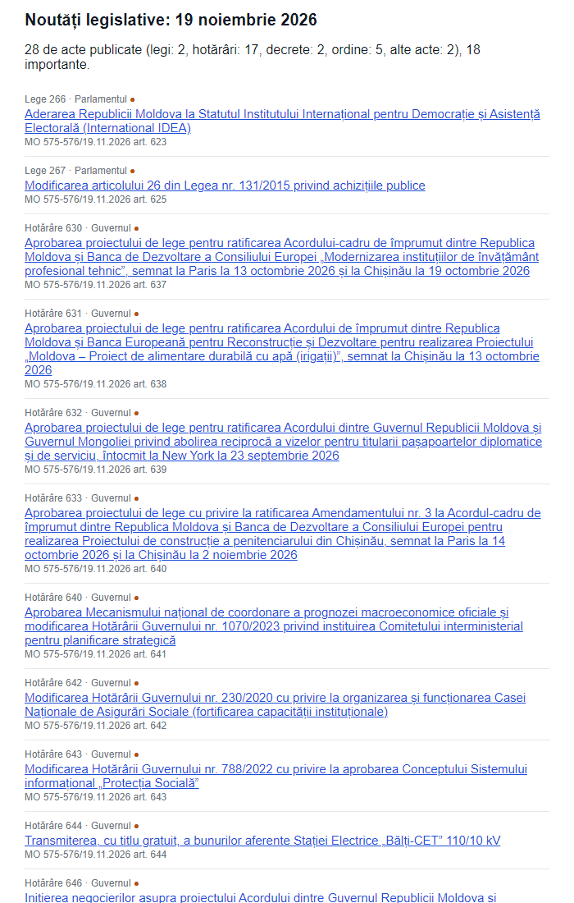

# Daily Monitorul Oficial digest by e-mail

Every morning, one HTML e-mail with the acts published that day in Moldova's Monitorul Oficial: laws, government
decisions, orders, the important ones first, each with its reference and link. Python standard library only.

**Who it is for:** lawyers, compliance and HR teams, accountants, journalists: people who must know what changed
today without reading the whole gazette.

Real output from the live run on 19 Nov 2026, sent to a local debug SMTP server:

```
$ python digest.py
Noutăți legislative: 19 noiembrie 2026: 28 acts, sent to team@example.org
$ python digest.py --date 2026-11-15 --skip-empty
2026-11-15: no acts published, nothing sent
```

The HTML part of that message (the text part carries the same list):



The footer of the mail keeps the source line: "● important · Sursa: Monitorul Oficial · Date: Satelit (satelit.md)".

## Run it in 3 commands

```sh
cd satelit-examples/law-digest-email-python
export SATELIT_API_KEY=sat_live_... SMTP_HOST=smtp.example.org SMTP_USER=digest@example.org SMTP_PASS=... MAIL_TO=team@example.org
python digest.py
```

| Variable | Default | |
|---|---|---|
| `SMTP_HOST`, `SMTP_PORT` | `587` | your mail server |
| `SMTP_SECURITY` | `starttls` | `ssl` for port 465, `none` for a local relay |
| `SMTP_USER`, `SMTP_PASS` | | login, when the server needs one |
| `MAIL_FROM`, `MAIL_TO` | `SMTP_USER` | `MAIL_TO` may hold several addresses, comma separated |

Options: `--date YYYY-MM-DD` (default today), `--out file.html` (write, send nothing), `--skip-empty` (no mail on a
day without acts).

## Credits

2 per run (`/law/digests/{date}`). One run a working day: about 44 a month.

## Schedule it

The day's digest is ready by about 08:30 Chișinău time.

```cron
45 8 * * 1-5 cd /opt/law-digest && . ./.env && python3 digest.py --skip-empty
```

Windows: `schtasks /Create /TN "MO digest" /SC WEEKLY /D MON,TUE,WED,THU,FRI /ST 08:45 /TR "cmd /c cd /d C:\law-digest && python digest.py --skip-empty"`.

## Try it locally

```sh
python dev_smtp.py 18355 out/ &          # accepts every message and saves it as out/*.eml
SMTP_HOST=127.0.0.1 SMTP_PORT=18355 SMTP_SECURITY=none MAIL_TO=me@example.org python digest.py
python -m unittest -v                    # offline tests
```

## Troubleshooting

- `SMTPAuthenticationError`: most providers want an app password, not the account's.
- `Satelit 404` is handled: a day without a digest is a day without publications (`--skip-empty` sends nothing).

## Pe scurt (română)

Un e-mail HTML zilnic cu actele publicate în Monitorul Oficial, cele importante primele. Doar biblioteca standard
Python; SMTP din variabile de mediu; 2 credite pe zi.
